# CampusShare UML & Data Flow Diagrams (US-01 to US-09)

## 1. DFD Level 0 — Context Diagram

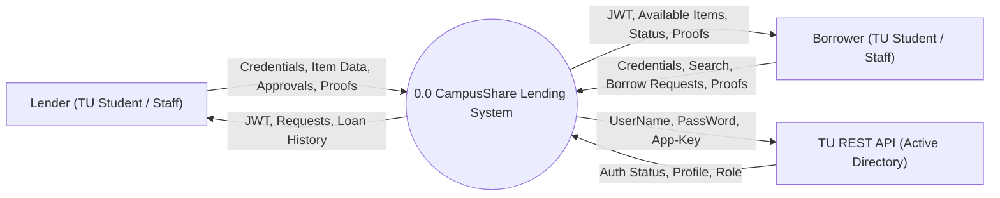

---

## 2. DFD Level 1 — System Processes (US-01 to US-09)

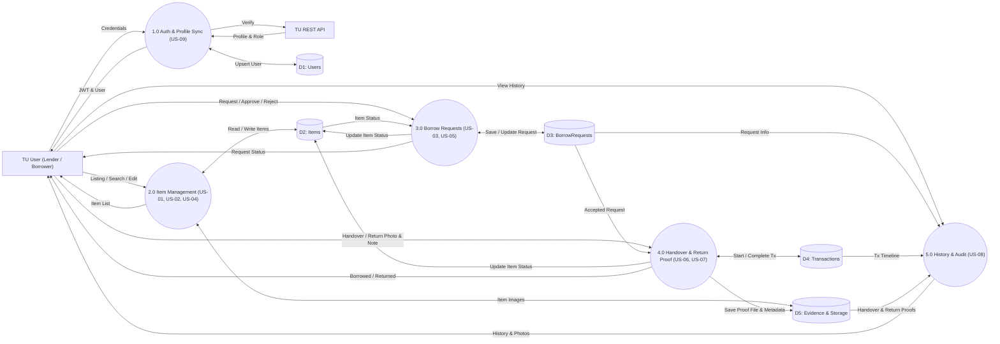

---

## 3. Domain Model (UML Class Diagram)

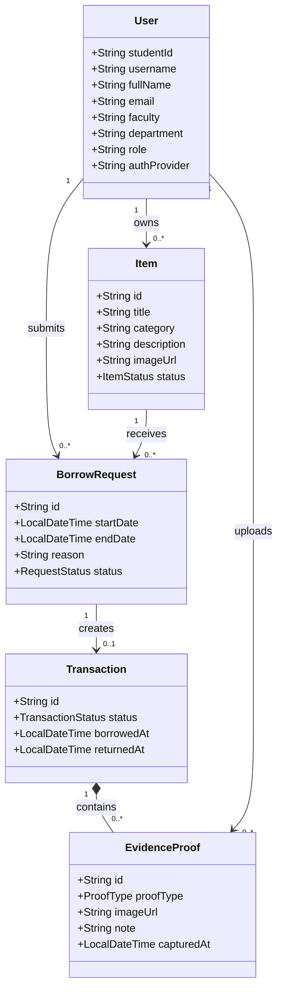

---

## 4. Entity Lifecycle (State Diagram)

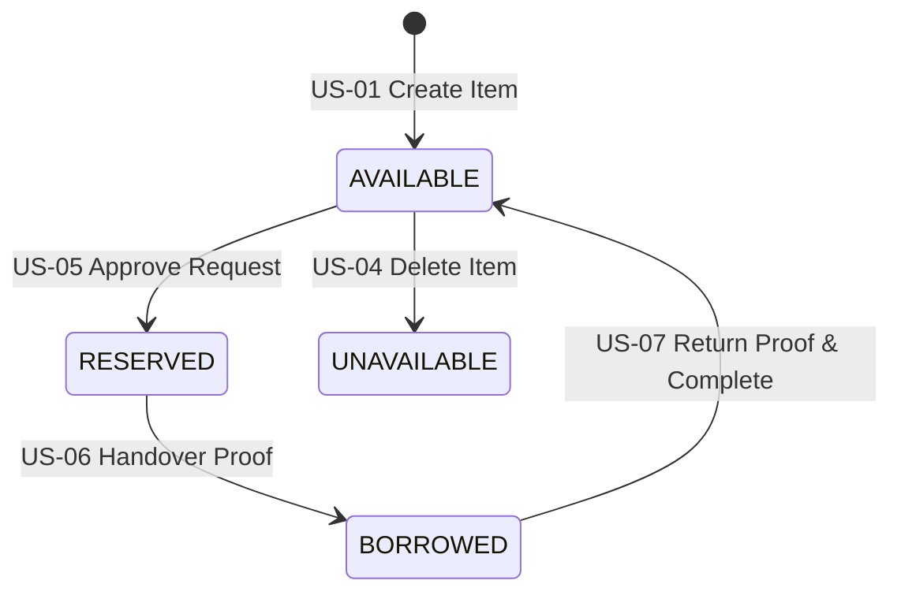

---

## 5. Compact Sequence Diagrams (US-01 to US-09)

### US-01: Create Item Listing

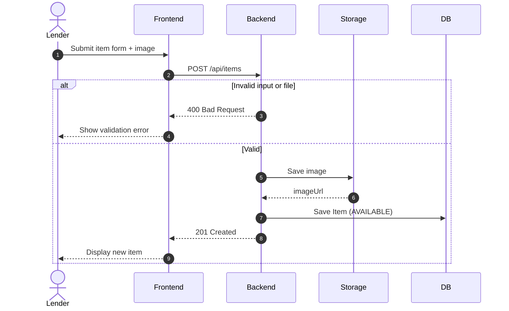

### US-02: Browse Available Items

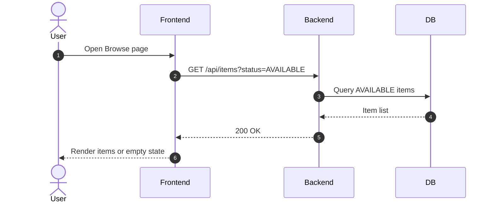

### US-03: Submit Borrow Request

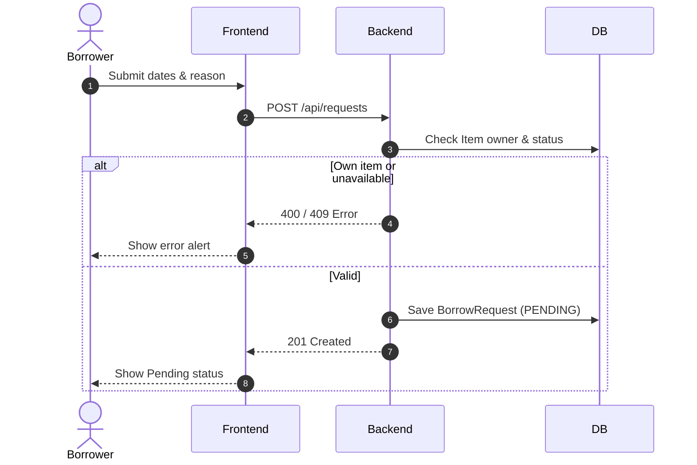

### US-04: Update or Delete Item Listing

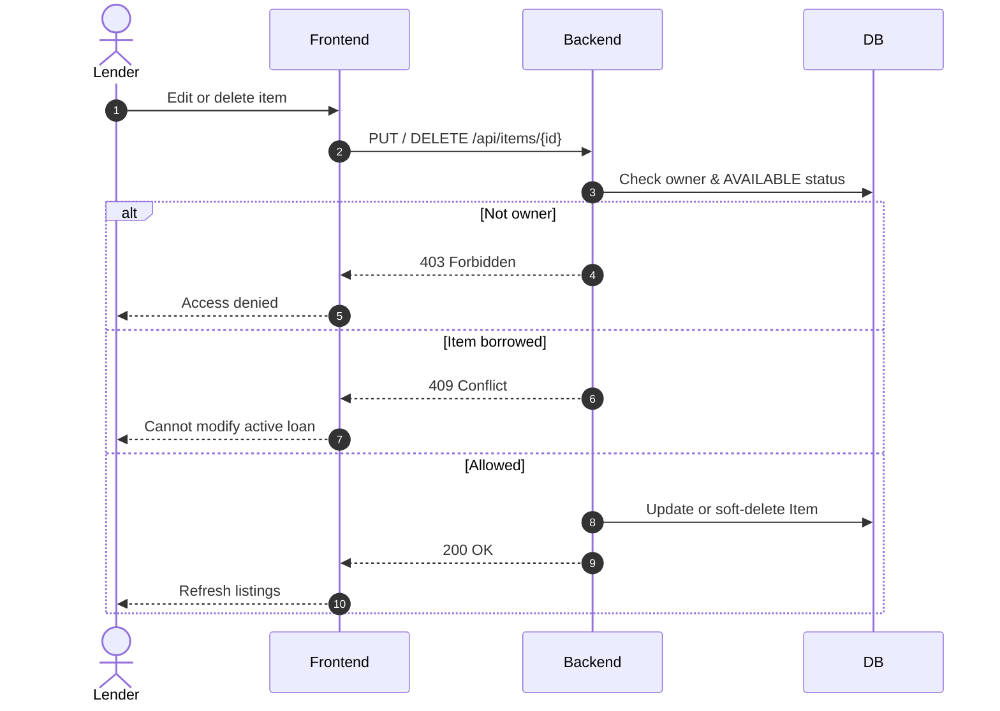

### US-05: Approve or Reject Borrow Request

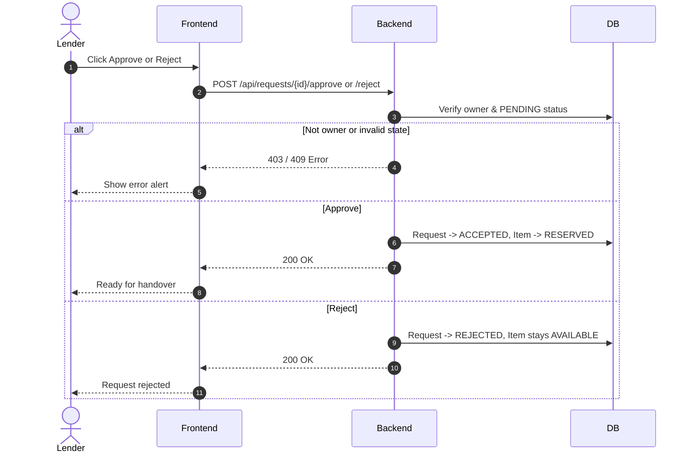

### US-06: Record Handover Evidence

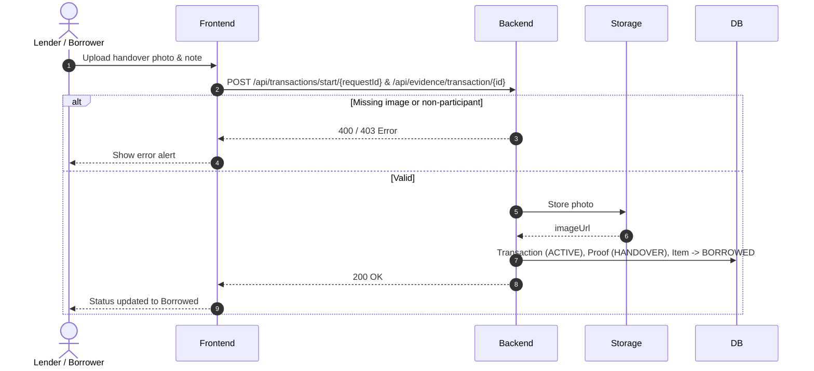

### US-07: Record Return Evidence

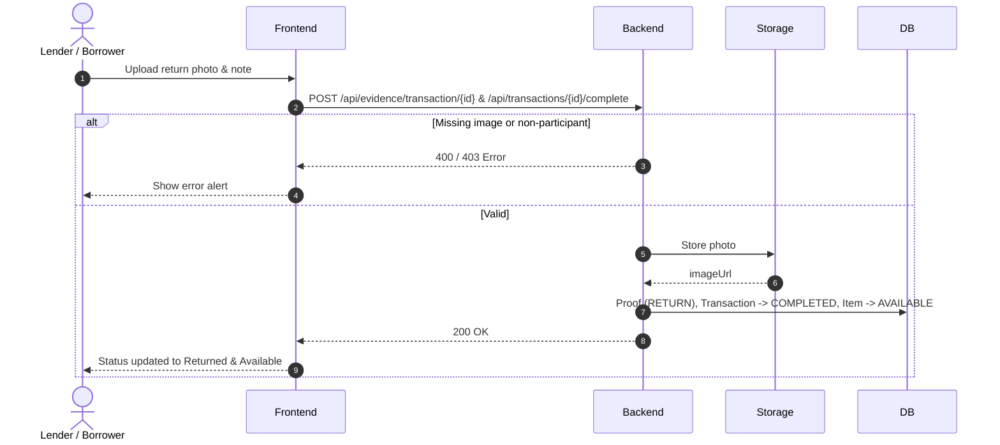

### US-08: View Borrow History & Evidence

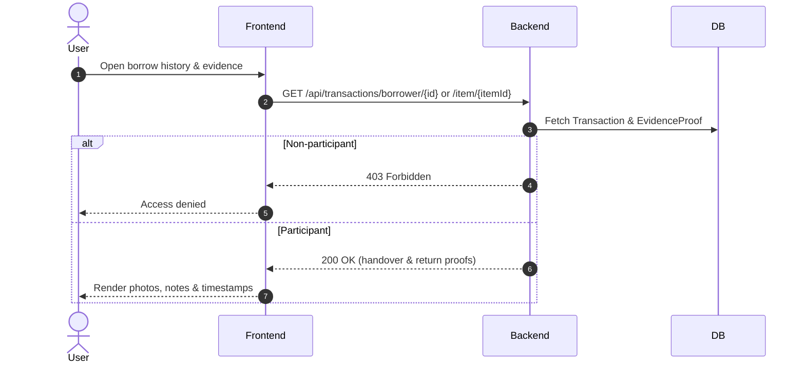

### US-09: Login with TU Account

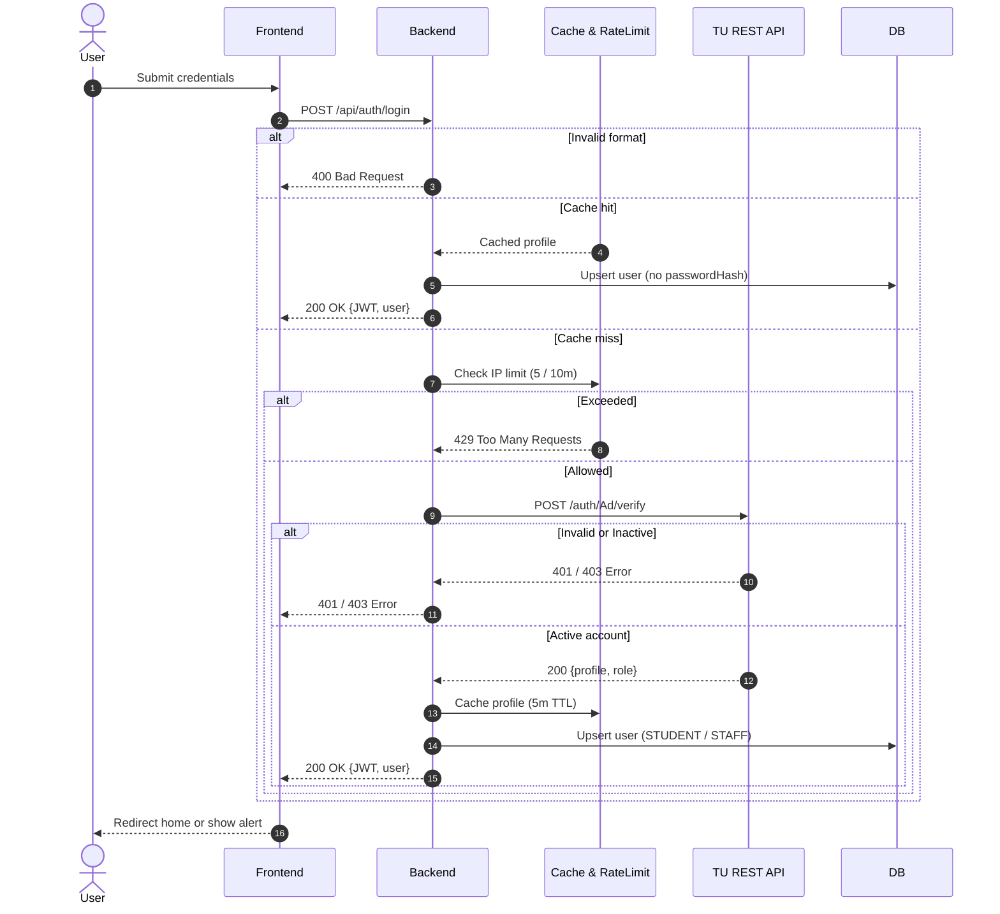
